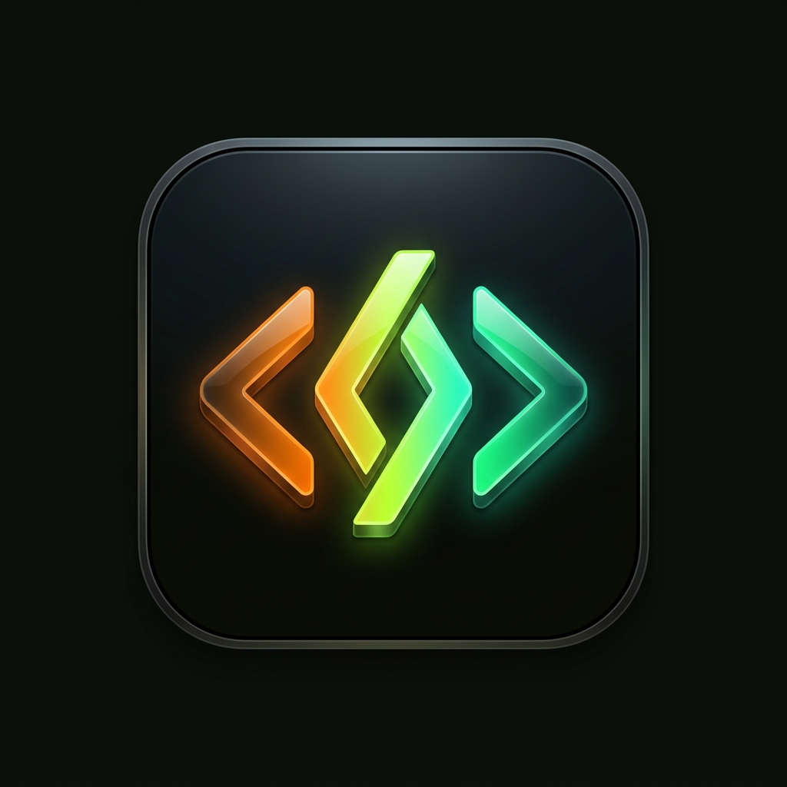

<div align="center">



# BharatCode Studio

### The Open-Source AI Code Editor Powered by BharatCode

[](LICENSE.txt)
[](#install)
[](https://bharatcode.ai)
[](#about-this-fork)

<p align="center">
  <b>Fast. Private. Autonomous.</b><br>
  Built on top of VS Code with first-class native integration for Indian AI models, shared capacity queues, and intelligent coding agents.
</p>

[Download](#install) • [Features](#key-features) • [Quickstart](#build-from-source) • [About This Fork](#about-this-fork) • [Documentation](https://bharatcode.ai)

---

</div>

> [!IMPORTANT]
> **About This Fork**: **BharatCode Studio** is an open-source, white-labeled fork of [Kodia](https://github.com/jcommaret/kodia), [Void](https://voideditor.com), and [VS Code](https://github.com/microsoft/vscode). All UI branding, application icons, configuration directories, and native AI endpoints have been tailored to run out-of-the-box with **[BharatCode](https://bharatcode.ai)**.

---

## ⚡ Key Features

<table>
  <tr>
    <td width="50%">
      <h3>🇮🇳 Native BharatCode Integration</h3>
      Zero-configuration setup for BharatCode. Pre-wired with <code>glm-5.3-flash</code> (262k context, default for Chat, Agent, and Autocomplete) and <code>deepseek-v4.1-flash</code> (1M context) via an OpenAI-compatible SSE streaming gateway.
    </td>
    <td width="50%">
      <h3>🤖 Autonomous Agent Mode</h3>
      An AI agent capable of multi-step planning, creating and editing files across your workspace, running terminal commands, and reading errors—all with your explicit approval.
    </td>
  </tr>
  <tr>
    <td width="50%">
      <h3>🔍 Three Sidebar Modes</h3>
      <ul>
        <li><b>Normal</b>: Direct technical Q&A and code explanation.</li>
        <li><b>Gather</b>: Reads and indexes codebase context to answer repository questions without modifying files.</li>
        <li><b>Agent</b>: Full tool-calling agent with terminal execution.</li>
      </ul>
    </td>
    <td width="50%">
      <h3>⚡ Ctrl+K & Inline Diffs</h3>
      Highlight any code block, press <code>Ctrl+K</code> (or <code>Cmd+K</code>), and type instructions. Inspect changes as interactive side-by-side or inline diffs with instant <b>Accept</b> and <b>Reject</b> actions.
    </td>
  </tr>
  <tr>
    <td width="50%">
      <h3>🧠 Project Memory & Custom Rules</h3>
      Persists project context and architectural decisions automatically in <code>.bharatcode/memory.md</code>. Supports custom workspace rules via <code>.bharatcoderules</code>, <code>.voidrules</code>, <code>AGENTS.md</code>, or <code>.cursorrules</code>.
    </td>
    <td width="50%">
      <h3>🔄 Checkpoints & Rollback</h3>
      Instant timeline checkpoints after every AI edit. Never worry about an agent breaking your build—revert any turn with a single click.
    </td>
  </tr>
</table>

---

## 📦 Multi-Provider Flexibility

While **BharatCode** is the default native provider, BharatCode Studio remains 100% open and un-locked:

- **Cloud Providers**: Anthropic (Claude 3.5 Sonnet), OpenAI (GPT-4o), Google Gemini, Groq, Mistral, DeepSeek, xAI, and OpenRouter.
- **Local Privacy-First Models**: Connect directly to **Ollama**, **LM Studio**, **vLLM**, or Apple Silicon **MLX** without sending code outside your machine.
- **Enterprise Endpoints**: Native compatibility with any custom OpenAI-compatible server, LiteLLM proxy, AWS Bedrock, or Azure OpenAI.

---

## 🚀 Downloads & Quick Install (v1.0.0)

Direct links to binary installers for all platforms from the [latest release](https://github.com/Sreeju7733/bharatcode-studio/releases/tag/v1.0.0):

| Platform | Architecture | Installer Type | Download Link | Quick Terminal Install |
| :--- | :--- | :--- | :--- | :--- |
| **Windows** | x64 (64-bit) | **User Setup (.exe)** | [Download .exe](https://github.com/Sreeju7733/bharatcode-studio/releases/download/v1.0.0/BharatCode-Studio-User-Setup-x64-1.0.0.exe) | `winget install BharatCode.BharatCodeStudio` |
| **Windows** | x64 | **Portable (.zip)** | [Download .zip](https://github.com/Sreeju7733/bharatcode-studio/releases/download/v1.0.0/BharatCode-Studio-win32-x64-1.0.0.zip) | `scoop install bharatcode-studio` |
| **Windows** | ARM64 | **User Setup (.exe)** | [Download .exe](https://github.com/Sreeju7733/bharatcode-studio/releases/download/v1.0.0/BharatCode-Studio-User-Setup-arm64-1.0.0.exe) | — |
| **macOS** | Apple Silicon (`arm64`) | **Apple Disk Image (.dmg)** | [Download .dmg](https://github.com/Sreeju7733/bharatcode-studio/releases/download/v1.0.0/BharatCode-Studio-darwin-arm64-1.0.0.dmg) | `brew install --cask bharatcode-studio` |
| **macOS** | Intel (`x64`) | **Apple Disk Image (.dmg)** | [Download .dmg](https://github.com/Sreeju7733/bharatcode-studio/releases/download/v1.0.0/BharatCode-Studio-darwin-x64-1.0.0.dmg) | `brew install --cask bharatcode-studio` |
| **Linux (Debian/Ubuntu)** | x64 (`amd64`) | **Debian Package (.deb)** | [Download .deb](https://github.com/Sreeju7733/bharatcode-studio/releases/download/v1.0.0/bharatcode-studio-1.0.0-linux-amd64.deb) | `sudo dpkg -i bharatcode-studio-*.deb` |
| **Linux (Debian/Ubuntu)** | ARM64 (`arm64`) | **Debian Package (.deb)** | [Download .deb](https://github.com/Sreeju7733/bharatcode-studio/releases/download/v1.0.0/bharatcode-studio-1.0.0-linux-arm64.deb) | `sudo dpkg -i bharatcode-studio-*.deb` |
| **Linux (Fedora/RHEL)** | x64 | **RPM Package (.rpm)** | [Download .rpm](https://github.com/Sreeju7733/bharatcode-studio/releases/download/v1.0.0/bharatcode-studio-1.0.0-linux-x86_64.rpm) | `sudo dnf install ./bharatcode-studio-*.rpm` |
| **Linux (Fedora/RHEL)** | ARM64 | **RPM Package (.rpm)** | [Download .rpm](https://github.com/Sreeju7733/bharatcode-studio/releases/download/v1.0.0/bharatcode-studio-1.0.0-linux-aarch64.rpm) | `sudo dnf install ./bharatcode-studio-*.rpm` |
| **Linux (Universal)** | x64 | **AppImage** | [Download .AppImage](https://github.com/Sreeju7733/bharatcode-studio/releases/download/v1.0.0/BharatCode-Studio-1.0.0-x86_64.AppImage) | `chmod +x *.AppImage && ./*.AppImage` |
| **Linux (Universal)** | x64 | **Tarball (.tar.gz)** | [Download .tar.gz](https://github.com/Sreeju7733/bharatcode-studio/releases/download/v1.0.0/bharatcode-studio-linux-x64-1.0.0.tar.gz) | `tar -xzf *.tar.gz && ./bharatcode-studio/bin/bharatcode-studio` |
| **Linux (Arch / Manjaro)** | x64 / ARM64 | **PKGBUILD Package** | [PKGBUILD](packaging/aur) | `makepkg -si` (Direct Build) |

---

### Platform Setup Notes

- **Arch Linux / Manjaro (Direct PKGBUILD Install)**:
  Install directly via `makepkg` without waiting for AUR registration:
  ```bash
  git clone https://github.com/Sreeju7733/bharatcode-studio.git
  cd bharatcode-studio/packaging/aur
  makepkg -si
  ```


- **macOS Keychain Permission**: On first launch, macOS will request access to *"BharatCode Studio Safe Storage"*. Select **Always Allow** so the editor can securely save your API keys in the macOS Keychain.
- **Linux Sandbox**: If running the AppImage or raw tarball on minimal distributions without unprivileged user namespaces, launch with `bharatcode-studio --no-sandbox` if prompted.

## 🛠️ Build from Source

### Prerequisites
- [Node.js](https://nodejs.org/) `v24.18.0` (or newer)
- Python 3.x
- Platform build toolchain:
  - macOS: `xcode-select --install`
  - Linux: `build-essential`, `libsecret-1-dev`, `pkg-config`
  - Windows: Visual Studio Build Tools (C++ workload)

### Compilation Steps

```bash
# 1. Clone the repository
git clone https://github.com/Sreeju7733/bharatcode-studio.git
cd bharatcode-studio

# 2. Install dependencies & compile React UI
npm install
npm run buildreact

# 3. Start the continuous TypeScript compiler
npm run watch

# 4. Launch BharatCode Studio (in a separate terminal)
./scripts/code.sh        # Linux / macOS
.\scripts\code.bat       # Windows
```

---

## 📂 Configuration & Data Paths

BharatCode Studio uses completely isolated configuration paths so it will never conflict with an existing VS Code, Cursor, or Void installation:

| Platform | Configuration & Extension Path |
| :--- | :--- |
| **macOS** | `~/.bharatcode-studio` & `~/Library/Application Support/BharatCode Studio` |
| **Linux** | `~/.bharatcode-studio` & `~/.config/BharatCode Studio` |
| **Windows** | `%USERPROFILE%\.bharatcode-studio` & `%APPDATA%\BharatCode Studio` |

---

## 📄 License & Attribution

- BharatCode Studio's custom additions and white-label modifications are licensed under the **Apache License 2.0**.
- The core Visual Studio Code editor is licensed under the **MIT License** by Microsoft Corporation.
- Special thanks to the **Kodia**, **Void**, and **VSCodium** communities for their open-source tooling.

---

<div align="center">
  <b>Built for developers in Bharat and around the world.</b><br>
  <sub>Powered by <a href="https://bharatcode.ai">BharatCode AI</a></sub>
</div>
